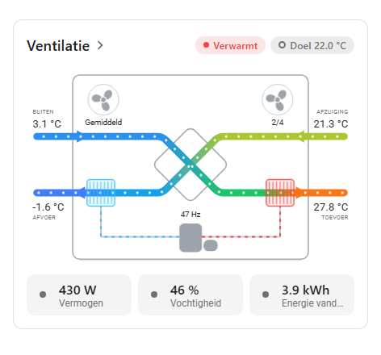
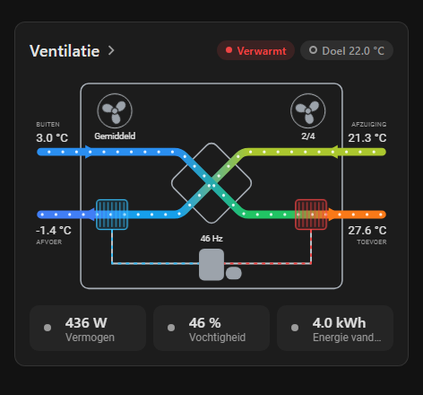
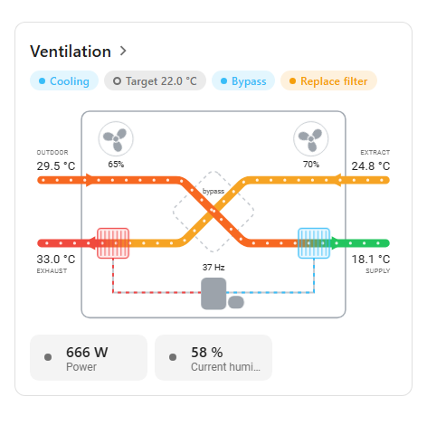

# HRV Card

Custom Lovelace card for a heat-recovery ventilation unit (HRV/WTW) with a heat pump.

The card draws the unit as an animated diagram:

- **Air streams:** both streams are coloured by temperature from inlet to outlet and pass through the heat exchanger.
- **Fans:** they spin at their real speed.
- **Coils:** they glow hot or cold depending on what the heat pump is doing (heating, cooling, drying, defrost).
- **Refrigerant loop:** shows the compressor frequency.

Status chips show the mode, the set temperature, the bypass and the filter alarm. Optional tiles show extra values such as power or humidity. The card follows the active Home Assistant theme and is available in English, Dutch, French and German.

Built with **Vue 3 + TypeScript + Vite** and shipped as a single JavaScript module.

<p>
  
  
  
</p>

*The first two screenshots show the light and dark theme (Dutch, heating in winter). The third shows English, cooling in summer with the bypass open and a filter alarm. They come from the dev page with mocked data; regenerate them with `npm run screenshots`.*

## Install in Home Assistant

### HACS (recommended)

[](https://my.home-assistant.io/redirect/hacs_repository/?owner=lieven121&repository=HA-hrv-card&category=plugin)

1. Click the button above. Alternatively, in HACS go to **⋮ → Custom repositories** and add `https://github.com/lieven121/HA-hrv-card` with type *Dashboard*.
2. Click **Download**. HACS adds the dashboard resource for you.
3. Hard-refresh the browser and add the card via **Add card → HRV Card**. You can set everything in the visual editor.

HACS shows new releases as updates. Pre-releases only appear after you turn on **Show beta versions** for the repository in HACS.

### Manual

1. Download `hrv-card.js` from the [latest release](https://github.com/lieven121/HA-hrv-card/releases). You can also build it yourself: `npm install && npm run build` produces `dist/hrv-card.js`.
2. Copy it to `/config/www/hrv-card.js`.
3. Go to **Settings → Dashboards → ⋮ → Resources → Add resource**. Use the URL `/local/hrv-card.js?v=1.0.0` with type *JavaScript module*. Change the `?v=` on every update so browsers don't keep the old file.
4. Hard-refresh the browser and add the card via **Add card → HRV Card**.

The browser console logs `HRV-CARD v<version>`, so you can check which version is loaded.

## Configuration

Everything can be set in the visual editor. In YAML, every option is optional:

```yaml
type: custom:hrv-card
name: Ventilation
entity: climate.hrv         # main entity: opens when tapping the title (shows a chevron)
language: auto              # auto | en | nl | fr | de (captions & status)
efficiency: 0.85            # used to estimate air temp between exchanger and coils
decimals: 1
show_header: true
entities:
  outdoor_temp: sensor.hrv_outdoor_temperature
  extract_temp:                       # any source can read an attribute instead of the state
    entity: climate.hrv
    attribute: current_temperature
  supply_temp: sensor.hrv_supply_temperature
  exhaust_temp: sensor.hrv_exhaust_temperature
  supply_fan: { entity: climate.hrv, attribute: fan_mode }
  exhaust_fan: sensor.hrv_exhaust_fan_step
  compressor: sensor.hrv_compressor_frequency
  heat_pump_mode: climate.hrv                                        # heat/cool/auto/dry/fan_only/off (+defrost)
  target_temp: { entity: climate.hrv, attribute: temperature }       # used by auto
  heat_pump_action: { entity: climate.hrv, attribute: hvac_action }  # optional, wins over the auto logic
  defrost: binary_sensor.hrv_defrost
  bypass: binary_sensor.hrv_bypass
  filter: binary_sensor.hrv_filter_alarm
  efficiency: sensor.hrv_efficiency   # % or 0–1
fan_speeds:                 # slowest → fastest; label = what the card shows
  - { state: low,    label: Laag }
  - { state: medium, label: Gemiddeld }
  - { state: high,   label: Hoog }
# supply_fan_speeds / exhaust_fan_speeds override fan_speeds per fan
fan_levels: 4               # only if a fan reports numeric levels instead of %
heat_pump_states:           # only if your values differ from HA's (comma-separated)
  heat: verwarmen
  fan_only: ventilatie, vent
auto_deadband: 0.5          # auto: heat if target > extract + 0.5, cool if target < extract − 0.5
extra:
  - entity: sensor.hrv_power
    name: Power
    icon: mdi:flash
  - entity: climate.hrv
    attribute: current_humidity
    name: Humidity
    unit: "%"
```

### How the card decides what the heat pump is doing

The card checks these sources in order and uses the first one that applies:

1. A **defrost** sensor that is on.
2. A **current action** entity, such as `hvac_action`.
3. The **mode**. In `auto`, the card compares the set temperature with the extract air, which is the room temperature, within `auto_deadband`.
4. If there is no mode entity, the compressor frequency and the supply/extract temperatures decide.

When the mode is `off`, the air streams turn grey and the fans stop.

### Theme variables

`--hrv-casing-color`, `--hrv-line-color`, `--hrv-machine-color` and `--hrv-flow-off-color` can be set in a Home Assistant theme.

## Releasing

1. Bump `version` in `package.json`, commit, and tag it: `git tag -a v1.2.3 -m v1.2.3`.
2. Run `npm run build`.
3. Create a GitHub release for the tag with `dist/hrv-card.js` attached: `gh release create v1.2.3 dist/hrv-card.js`. Add `--prerelease` to test first.

HACS installs that release asset. Pre-releases only reach users who turned on beta versions.

## Development

| Command               | What it does                                                           |
| --------------------- | ---------------------------------------------------------------------- |
| `npm run dev`         | Dev page with two cards on a mocked `hass` (no HA needed)              |
| `npm run build`       | Type-check + production bundle in `dist/`                              |
| `npm test`            | Unit tests for the heat-pump logic, fans, air flow and the editor      |
| `npm run typecheck`   | `vue-tsc` only                                                         |
| `npm run screenshots` | Regenerate `docs/*.png` (needs Edge or Chrome; `BROWSER=` to override) |

## Layout

```
src/
  main.ts                  registers the elements + the "Add card" entry
  elements.ts              Vue custom elements + HA card API (setConfig, getCardSize, …)
  HrvCard.vue              root: theme tokens
  const.ts                 sources, mode defaults, resolveConfig()
  i18n.ts                  en/nl/fr/de strings
  types.ts                 config + minimal Home Assistant types
  composables/useHrv.ts    shared context: reads the sources and derives the whole card state
  logic/                   pure functions (unit-tested): heat pump, fans, air flow, colours, formatting
  components/              header, diagram (+ fan, coil), extra tiles
  editor/                  visual editor: sections, source pickers, fan steps, tiles + pure config helpers
dev/                       mock hass + dev page entry (?theme=dark, ?card=1)
tests/                     vitest
scripts/screenshots.mjs    README screenshots → docs/
```

### Notes

- Every `.vue` file is compiled in custom-element mode (`customElement: true` in `vite.config.ts`). As a result, each component's `<style>` lands in the shadow root of the card or editor. All styles share that one shadow root, so keep class names distinct.
- The editor keeps empty rows, such as a new fan step or tile, in its own copy and leaves them out of the config it emits. It ignores its own config when Home Assistant sends it back, so those rows don't vanish while you type.

## License

[MIT](LICENSE)
